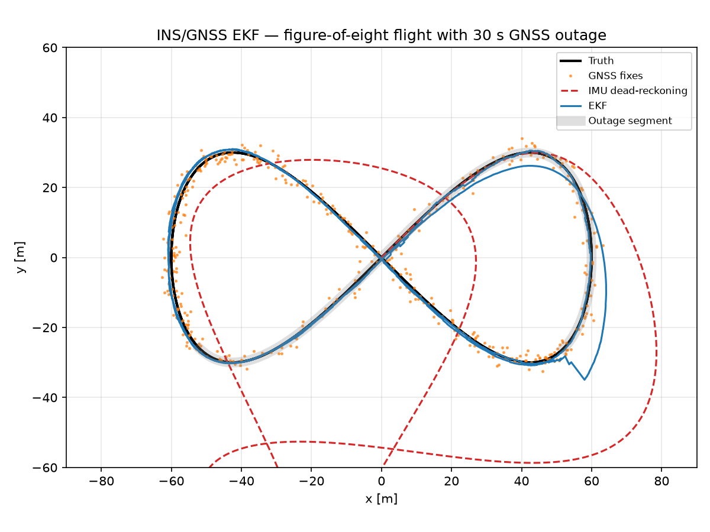
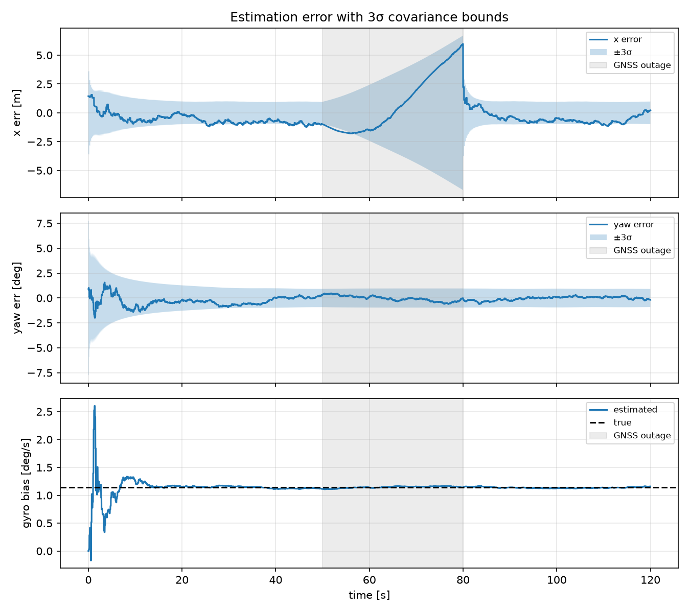
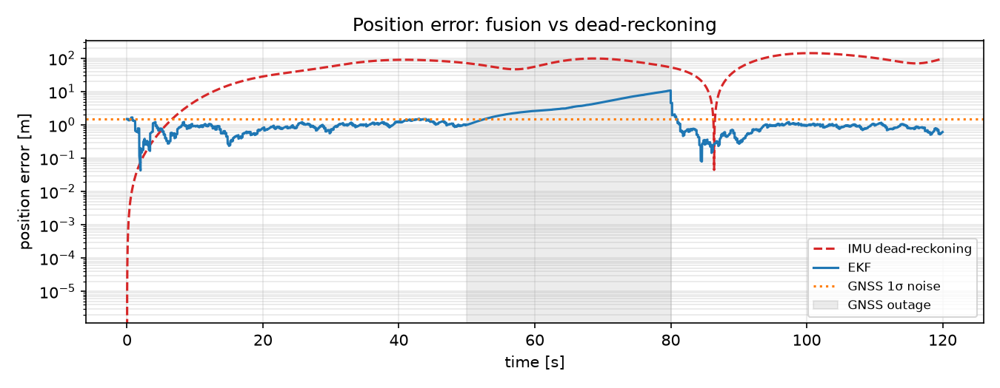

# UXV INS/GNSS Navigation EKF — with GNSS-denied flight

A compact **Extended Kalman Filter** that fuses a drone's **IMU** (accelerometer + gyro),
**GNSS** and **magnetometer** to estimate position, velocity, heading and gyro bias, and
keeps navigating through a **30-second GNSS outage**. Everything is simulated in Python, so
it runs anywhere with `numpy` and `matplotlib`.



## Results (default scenario)

| Metric | Value |
|---|---|
| GNSS-only position RMSE | 2.08 m |
| IMU-only dead-reckoning RMSE | 75.7 m |
| **EKF position RMSE (GNSS available)** | **0.93 m** |
| EKF max position error during 30 s outage | 10.8 m (vs >70 m dead-reckoning) |
| EKF heading RMSE | 0.42° |
| Gyro bias (true / estimated) | 1.146 / 1.159 °/s |
| Mean GNSS NIS (≈2.0 for a consistent 2-D filter) | 2.24 |

The estimation error stays inside the filter's own ±3σ covariance bounds, including during
the outage, so the filter's reported uncertainty can be trusted:




## Filter design

**State** `x = [px, py, vx, vy, ψ, b_g]`: 2-D position, velocity, heading and gyro bias.

**Prediction (IMU, 100 Hz)**: strapdown mechanisation, with IMU readings used as control inputs:

```
ψ⁺ = ψ + (ω_meas − b_g)·dt
a_w = R(ψ)·a_body
v⁺ = v + a_w·dt
p⁺ = p + v·dt + ½·a_w·dt²
b_g⁺ = b_g                  (random walk)
P⁺ = F P Fᵀ + G Q_imu Gᵀ    (F = ∂f/∂x, G = ∂f/∂u, both analytic)
```

**Updates**
- GNSS position at 5 Hz: `H = [I₂ 0]`, dropped between t = 50 s and 80 s
- Magnetometer heading at 10 Hz: `H = e_ψ`, innovation wrapped to [−π, π)
- Joseph-form covariance update for numerical stability
- NIS (normalised innovation squared) logged as a consistency check

**Realistic imperfections in the simulation**
- Gyro bias of 1.1 °/s that the filter must estimate. Heading updates make it observable.
- Accelerometer bias that is deliberately *not* in the filter model. This is what causes the
  drift during the outage. The filter covers it by inflating its process noise, which is a
  normal tuning trade-off in practice.

## Run it

```bash
pip install numpy matplotlib pytest
python src/run.py          # prints metrics, writes plots to results/
python src/run.py --no-mag # remove the heading sensor and watch what happens
pytest -q                  # Jacobian checks + performance/consistency test
```

## Project layout

```
src/simulate.py   truth trajectory + noisy IMU / GNSS / magnetometer
src/ekf.py        EKF: model, analytic Jacobians, predict, GNSS & mag updates
src/run.py        runs EKF vs dead-reckoning, metrics, plots
tests/test_ekf.py numerical-vs-analytic Jacobians, accuracy & NIS consistency
```

## Possible extensions
- Add accelerometer bias to the state (8-state filter) and compare outage drift
- Add a GNSS-velocity or airspeed update, or zero-velocity updates
- Move to 3-D with a quaternion error-state EKF (the PX4 EKF2 / ArduPilot EKF3 style)
- Port the filter to C++ (Eigen) and wrap it as a ROS 2 node
